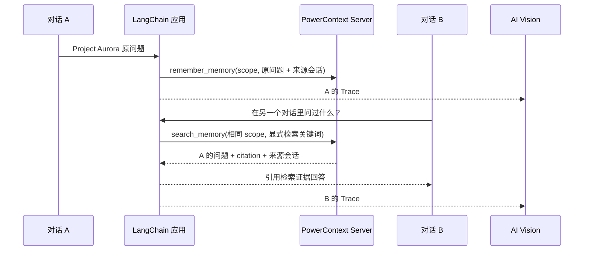

# LangChain × PowerContext × AI Vision

可向同事展示的跨对话上下文示例：一个人在对话 A 提问，在全新的对话 B 中检索到原问题，并在 AI Vision 中查看调用链。

- **LangChain**：构建 prompt → chat model → output parser 调用链。
- **PowerContext (pwcx)**：通过真实 Python Client SDK 写入和检索持久化 Memory。两个会话具有不同 `session_id`，显式使用相同 `scope_id`。
- **AI Vision OB**：使用其 Langfuse 兼容采集入口，通过 LangChain callback 和 observation 记录模型、检索、写入和会话信息；不需要另部署 Langfuse。

## 5 分钟演示

需要 Python 3.11+、Git、[uv](https://docs.astral.sh/uv/)，以及能访问 GitHub 的网络。

```bash
git clone https://github.com/kic635/langchain-pwcx-aivision-demo.git
cd langchain-pwcx-aivision-demo
uv sync --locked
cp .env.example .env
mkdir -p .demo-data
```

终端 1 启动独立 PowerContext 服务，使用本示例的独立数据库：

```bash
POWERCONTEXT_SERVER_DATABASE_URL="sqlite+aiosqlite:///$PWD/.demo-data/powercontext.db" \
  uv run powercontext server run
```

终端 2 启动界面：

```bash
uv run streamlit run app.py --server.address 127.0.0.1
```

打开终端显示的本地地址，按顺序操作：

1. 在**对话 A**点击发送：`Project Aurora 的上线时间能否定为 12 月 18 日，预算控制在 8 万元？`
2. 在**对话 B**保留检索关键词 `Project Aurora`，点击发送：`在另一个对话里，我问过 Project Aurora 什么问题？请引用原问题。`
3. 展开 B 的结果，核对 `hits[].text` 中的原问题、`source_session` 与 `citation`；A、B 的会话 ID 不同，scope 相同。
4. 关闭 B 的「启用 PowerContext 检索」，再次发送，比较命中数与回答。B 不会获得 A 的聊天记录。
5. 点击「开始全新演示」会生成新的 scope；历史数据仍保留在独立演示数据库中。

默认 `MODEL_MODE=fixture` 使用明确标注的确定性 LangChain 模型，无需模型 API Key；它直接显示真实 PowerContext 检索证据，适合先验证共享上下文路径。它不模拟真实模型的理解能力。默认检索为 FTS，B 的检索框显式使用 `Project Aurora` 关键词；自然语言问题仍完整传给模型。FTS 对整句问题有词项覆盖率要求，关键词框便于稳定展示；不宣称演示了向量语义检索。

也可以执行自动演示：

```bash
uv run python demo.py
```

脚本创建随机 scope，连续运行 A、B，并用另一个 scope 验证隔离；检索不到 A 或隔离失败会以非零状态退出。输出包含原问题、命中证据、会话和 Trace ID。

## 连接真实模型与 AI Vision

在 `.env` 中配置，现有 shell 环境变量优先：

```dotenv
MODEL_MODE=live
OPENAI_API_KEY=<你的模型密钥>
OPENAI_BASE_URL=<兼容 Chat Completions 的服务地址>
OPENAI_MODEL=<你的模型名称>

AIVISION_ENABLED=true
LANGFUSE_BASE_URL=<AI Vision 接入向导给出的平台根地址>
LANGFUSE_PUBLIC_KEY=<向导给出的 Agent UUID>
LANGFUSE_SECRET_KEY=<向导给出的同空间 SpaceKey>
```

三个 `LANGFUSE_*` 参数来自 **AI Vision → 接入向导 → LangChain**。`LANGFUSE_BASE_URL` 应使用向导给出的根地址，不要手动添加 `/v1/traces`。Langfuse SDK 负责发送到兼容 OTLP 入口。凭据仅放在本地 `.env`；不要上传密钥或真实业务问题。

修改配置后重启 Streamlit。再次运行 A、B，在 AI Vision 按结果中的 `trace_id` 检索，并按 `session_id` 对照两次独立会话。预期看到：

```text
shared-context-chat                session=A-... / B-...
├── powercontext.search_memory     检索输入、命中原文与引用
├── LangChain prompt/model/parser  callback 产生的子调用
└── powercontext.remember_memory   A 的原问题写入（B 默认不再写入）
```

检索与写入 observation 记录客户端调用耗时和结果；它们不代表 PowerContext 服务内部各阶段的 span。本例没有额外启用服务端 OTLP exporter。平台能否接收与保存，须按 Trace ID 在你的 AI Vision 实例中实际核验；本地 flush 成功不能证明平台落库。

`fixture` 也可启用 AI Vision，用于演示真实采集链路，模型节点会标注 fixture；同事演示真实模型效果时切换 `live`。

## 为什么这是跨对话共享



共享由应用显式指定的 scope 决定，session 仅标识对话。本例不使用全局聊天记录、LangChain checkpointer 或浏览器消息历史为 B 提供 A 的内容。问题以显式 Memory 写入，无需后台自动提取，也不会把「能否这样安排」转换为已批准的决定。

本地服务默认无认证，仅监听回环地址。若连接受保护的 PowerContext 服务，配置 `POWERCONTEXT_URL` 和 `POWERCONTEXT_TOKEN`。scope 是数据检索范围，不是用户权限机制；这是单人本地演示，不是可直接公开部署的多租户应用。

## 验证

启动 PowerContext 服务后运行：

```bash
uv run pytest -q
```

集成测试使用真实 PowerContext HTTP 服务、真实 LangChain runnable 和确定性模型，检查跨会话命中、禁用检索、独立 scope 隔离；另以本地 OTLP 接收器检查 SDK 实际导出的模型、检索、写入 span 与父子关系。CI 使用新建的本地数据库。真实模型和 AI Vision 平台落库需要自行配置服务后验收。

## 接口依据

- [PowerContext Python Client](https://github.com/oceanbase/powercontext/blob/aa81be0e28a061480e73706ebff90bd2a9526508/docs/en/docs/reference/interfaces.md)
- [PowerContext Server 配置](https://github.com/oceanbase/powercontext/blob/aa81be0e28a061480e73706ebff90bd2a9526508/docs/en/docs/reference/configuration.md)
- [AI Vision LangChain 接入示例](https://github.com/ob-labs/ai-vision-ob/blob/e739531c55b8a9f7e8d41d0fcd1295872233a18a/ai-vision/agent-plugins/langfuse/examples/langchain.yaml)

PowerContext 固定 Git commit，其他依赖由 `uv.lock` 锁定。MIT License。
